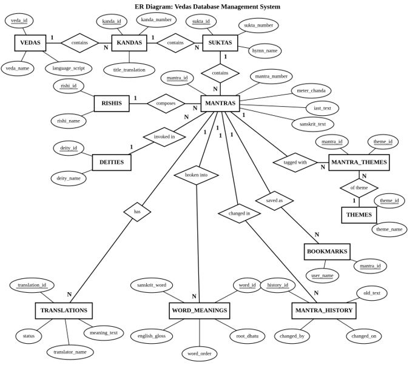
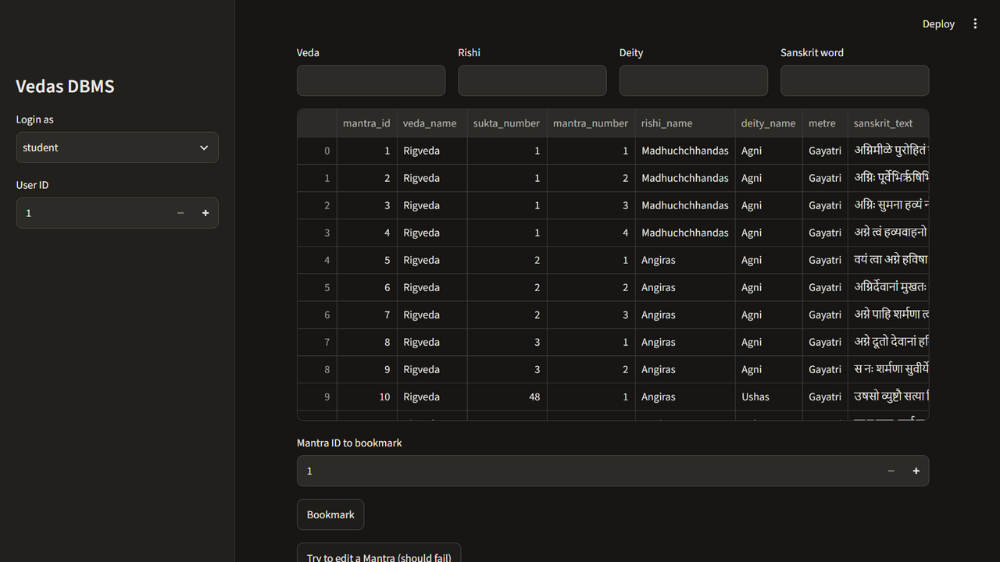
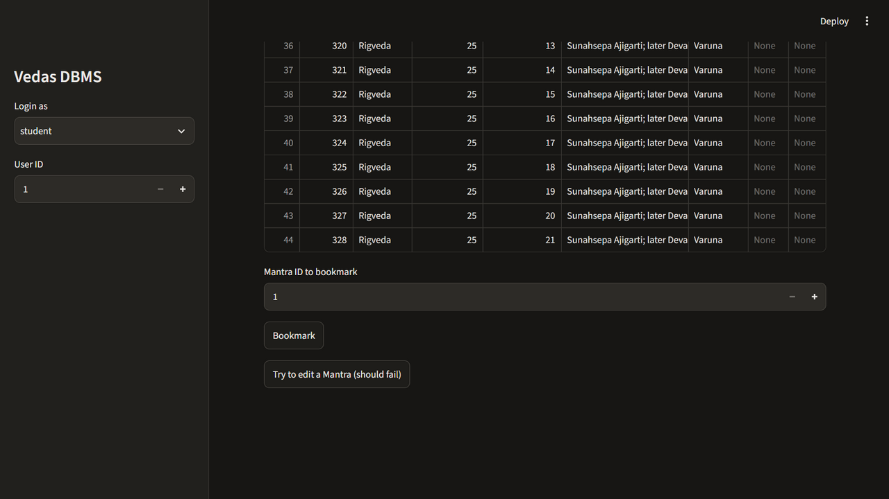

# Vedas Database Management System

A role-based database for a Vedic research library, built for **CSBB 204: Database Management Systems** (B.Tech CSE, 2nd year, 2026-27).

The Vedas are organised as **Veda → Kanda → Sukta → Mantra**. Each Mantra has a Rishi (seer), a deity, a metre, Sanskrit and IAST text, translations and word-by-word meanings. This project stores all of that in MySQL so it can be searched, reviewed and edited safely by different kinds of users.

## What it demonstrates

| DBMS feature | How it is used |
|---|---|
| **Security** | Four real MySQL users (`student_u`, `scholar_u`, `editor_u`, `admin_u`) with `GRANT` / `REVOKE`. Students can only read views. Only the admin can delete or approve. |
| **Concurrency control** | InnoDB transactions with `SELECT ... FOR UPDATE`. A second editor waits until the first commits. |
| **Views (external schema)** | Each role works through views, never the base tables. |
| **Normalisation** | Rishis and deities are stored once and linked. Translations and word meanings live in their own tables. |
| **SQL** | Joins (incl. `LEFT JOIN`), `LIKE`, `GROUP BY`, `HAVING`, transactions, constraints. |
| **Audit** | The old text of a Mantra is saved to `Mantra_History` before every edit. |

## Roles

| Role | Can do | MySQL privileges |
|---|---|---|
| Student | Search, bookmark Mantras | `SELECT` on student views; `INSERT`/`DELETE` on `Bookmarks` |
| Scholar | Add word meanings | `SELECT` on scholar view; `INSERT`/`UPDATE` on `Word_Meanings` |
| Editor | Add pending translations, edit Mantras | `INSERT`/`UPDATE` on `Translations`, `Mantras`; `INSERT` on `Mantra_History` |
| Admin | Approve translations, delete, reports | All privileges |

A translation is saved as `pending`. Students only see `approved` translations, and only the admin can change the status.

## Tech stack

MySQL 8 (InnoDB, utf8mb4) · Python 3.12+ · plain HTML/JavaScript page served by a small Python server · Streamlit (alternative UI)

## Project structure

```
vedas-dbms/
├── README.md
├── requirements.txt
├── .env.example          copy to .env and set passwords
├── sql/
│   ├── 01_schema.sql     13 tables
│   ├── 02_views.sql      5 views
│   ├── 03_roles.sql      4 users + GRANT/REVOKE
│   ├── 04_seed.sql       sample data with Sanskrit text
│   ├── 05_queries.sql    19 tracking and report queries
│   └── 06_concurrency_demo.sql
├── scripts/
│   ├── setup_db.py       builds the database from the SQL files
│   ├── download_dataset.py
│   ├── load_data.py      loads a Rigveda subset
│   └── test_locking.py   proves the locking behaviour
├── web/
│   ├── server.py         HTTP server (fixed queries only)
│   └── index.html        the web page
├── app/app.py            Streamlit version of the UI
└── docs/                 ER diagram and screenshots
```

## Setup

**Requirements:** Python 3.12+, MySQL 8 (running), Git.

```bash
git clone https://github.com/<your-username>/vedas-dbms.git
cd vedas-dbms

python -m venv venv
venv\Scripts\activate            # Windows PowerShell: .\venv\Scripts\Activate.ps1
pip install -r requirements.txt

copy .env.example .env           # then edit .env with your passwords
```

`.env` needs:

```
DB_HOST=localhost
DB_NAME=vedas_db
DB_PASSWORD=choose_a_password          # shared by the four app users
MYSQL_ROOT_PASSWORD=your_mysql_root_password
```

Build the database and load data:

```bash
python scripts/setup_db.py         # schema, views, roles, seed data
python scripts/download_dataset.py # optional: Rigveda text
python scripts/load_data.py        # optional: loads a 300-Mantra subset
```

Run the web page:

```bash
python web/server.py
```

Open **http://127.0.0.1:8000**, choose a role and a user ID (1 works). The server listens on this computer only.

Alternative UI: `streamlit run app/app.py`

## Demo (about 5 minutes)

1. **Student:** search "Agni", bookmark a Mantra, then press *Try to edit*. MySQL blocks it (error 1142).
2. **Editor:** add a translation. It is saved as pending.
3. **Student:** search again. The pending translation is not visible.
4. **Admin:** approve it. The student now sees it.
5. **Editor:** edit a Mantra. The old text appears in `Mantra_History`.
6. **Locking:** open two browser tabs as editor. Start a lock on one Mantra in tab 1. Tab 2 waits until tab 1 commits.
7. **Admin:** run the reports (Mantras per Veda, Rishi and deity, Suktas with no translation).

Headless proof of the locking behaviour: `python scripts/test_locking.py`

## Database design

Tables: `Vedas`, `Kandas`, `Suktas`, `Mantras`, `Rishis`, `Deities`, `Translations`, `Word_Meanings`, `Themes`, `Mantra_Themes`, `Bookmarks`, `Mantra_History`, `App_Users`.

- `Mantras` has `UNIQUE (sukta_id, mantra_number)`, so a Mantra number cannot repeat in a hymn.
- `Word_Meanings` has `UNIQUE (mantra_id, word_order)`.
- `Translations.status` is `pending` or `approved`.

The schema follows the three-level architecture: the **views** are the external schema, the **ER diagram** is the conceptual schema, and the **InnoDB files and indexes** are the internal schema.



## How the data is hidden

- The browser never sends SQL. It names a fixed action and the server runs a pre-written query.
- Database passwords stay in `.env` on the server and never reach the page.
- Each role connects as its own MySQL user, so MySQL enforces the permissions.
- Error messages shown in the browser are generic. Full details print only in the server console.

## Dataset

Seed data holds 42 Mantras with Sanskrit and IAST text. The optional loader adds a 300-Mantra subset of the Rigveda (Griffith translation) from a public text dump with about 59,000 lines. That dump has no Sanskrit text, so loaded Mantras carry only their English translation. The original source named in the synopsis is the Hugging Face dataset `siddharthjadhav6565/vedas`.

## Screenshots

| Student search | Dataset | Lock demo |
|---|---|---|
|  |  |  |

## Limitations

- The web login is a demo (role plus user ID, no password).
- Loaded Rigveda Mantras have no Sanskrit text.
- Built to run locally, not hardened for public hosting.

## Team

CSE1 Group 1, submitted to **Dr. Shelly Sachdeva**.

- Aadi Maraskolhe (251210001)
- Aduitiya Srivastava (251210006)
- Atharva Raghuvanshi (251210016)

## References

1. Elmasri and Navathe, *Fundamentals of Database Systems*, 7th ed., Pearson, 2016.
2. Silberschatz, Korth and Sudarshan, *Database System Concepts*, 7th ed., McGraw-Hill, 2019.
3. Hugging Face dataset `siddharthjadhav6565/vedas`.
4. MySQL 8.4 Reference Manual: GRANT, CREATE VIEW, Locking Reads.
